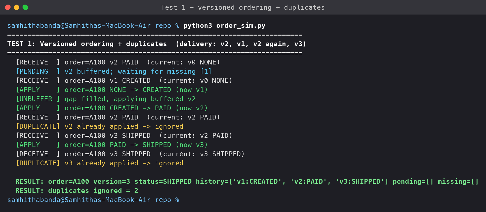
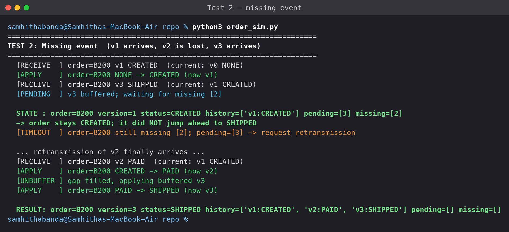
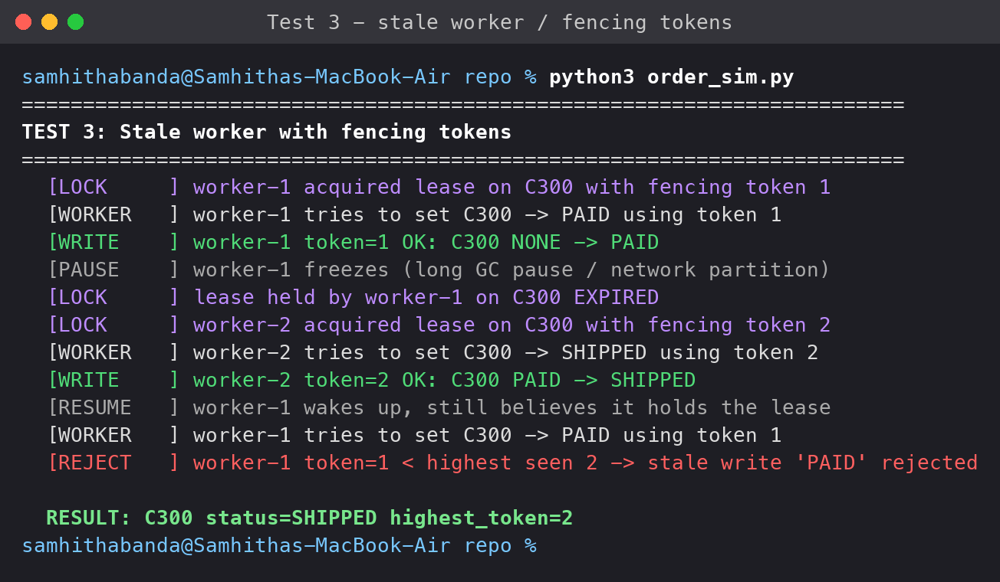
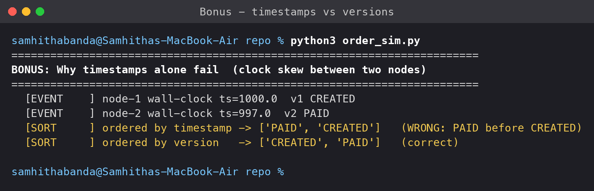
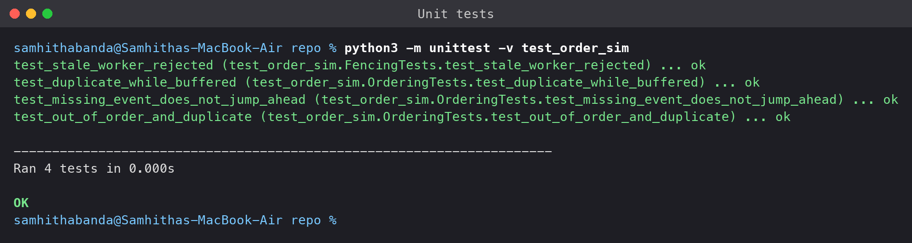

# Module 7 Assignment: Time, Ordering & Coordination

A small Python simulation of a distributed order-processing system. An order moves through versioned states:

```
v1 CREATED  ->  v2 PAID  ->  v3 SHIPPED
```

Events can arrive **late**, **out of order**, or **more than once**, and two workers can race to update the same order. The program handles all of these.

## Repository contents

| File | Purpose |
|------|---------|
| `order_sim.py` | The simulation: `OrderProcessor` (ordering, duplicates, missing events), `LockService`, `FencedOrderStore` and `Worker` (fencing tokens), plus the demo scenarios |
| `test_order_sim.py` | Unit tests for each requirement |
| `evidence/sample_output.txt` | Full terminal output of `python3 order_sim.py` |
| `evidence/test_output.txt` | Terminal output of the unit test run |
| `screenshots/` | Terminal screenshots of each test scenario and the unit tests |

## How to run

You need Python 3.8 or newer. There are no external dependencies.

```bash
git clone https://github.com/samhithabanda/Module-7-Assignment-Time-Ordering-Coordination.git
cd Module-7-Assignment-Time-Ordering-Coordination
python3 order_sim.py                     # runs all scenarios
python3 -m unittest -v test_order_sim    # runs the unit tests
```

## Design

Every event carries `order_id`, `version` and `status`. For each order the `OrderProcessor` stores the **last applied version**, the current status, and a **pending buffer** of events that arrived too early.

When an event arrives:

| Condition | Action |
|-----------|--------|
| `version <= applied version`, or the version is already buffered | **Duplicate**: ignored, and the duplicate counter goes up |
| `version == applied version + 1` | **Applied**, then the buffer is drained while the next version is present |
| `version > applied version + 1` | **Pending**: buffered, and the missing versions in between are recorded |

`check_timeouts()` represents a wait period expiring. It reports gaps that are still open so the system can ask for those events to be sent again.

For the stale-worker problem, a `LockService` gives each lease a **fencing token** that always increases. The `FencedOrderStore` remembers the highest token it has seen for each order and **rejects any write with a lower token**. Without this, a worker that paused (GC pause, network partition) after its lease expired could overwrite newer data.

---

## Evidence

Each section below has a terminal screenshot (in [`screenshots/`](screenshots)) followed by the same output as text. Everything comes from running `python3 order_sim.py` and `python3 -m unittest -v test_order_sim`. The complete raw logs are in [`evidence/`](evidence).

### 1. Correct event ordering + duplicate handling

Delivery order is **v2, v1, v2 again** (then v3 and another v3 duplicate).

* v2 arrives first, so it is **buffered** because v1 is missing.
* v1 arrives and is applied, and then the buffered v2 is applied right after it.
* The re-delivered v2 is detected as a **duplicate and ignored**.
* Final history is `v1 -> v2 -> v3` with 2 duplicates ignored.



Text version of the same output:

```
========================================================================
TEST 1: Versioned ordering + duplicates  (delivery: v2, v1, v2 again, v3)
========================================================================
  [RECEIVE  ] order=A100 v2 PAID  (current: v0 NONE)
  [PENDING  ] v2 buffered; waiting for missing [1]
  [RECEIVE  ] order=A100 v1 CREATED  (current: v0 NONE)
  [APPLY    ] order=A100 NONE -> CREATED (now v1)
  [UNBUFFER ] gap filled, applying buffered v2
  [APPLY    ] order=A100 CREATED -> PAID (now v2)
  [RECEIVE  ] order=A100 v2 PAID  (current: v2 PAID)
  [DUPLICATE] v2 already applied -> ignored
  [RECEIVE  ] order=A100 v3 SHIPPED  (current: v2 PAID)
  [APPLY    ] order=A100 PAID -> SHIPPED (now v3)
  [RECEIVE  ] order=A100 v3 SHIPPED  (current: v3 SHIPPED)
  [DUPLICATE] v3 already applied -> ignored

  RESULT: order=A100 version=3 status=SHIPPED history=['v1:CREATED', 'v2:PAID', 'v3:SHIPPED'] pending=[] missing=[]
  RESULT: duplicates ignored = 2
```

### 2. Missing event

Only v1 and v3 are sent, so v2 is missing.

* The order **stays at CREATED** and does **not** jump ahead to SHIPPED.
* v3 is recorded as `pending=[3]` and the gap is recorded as `missing=[2]`.
* After the timeout the missing version is reported and a retransmission is requested. When v2 finally arrives, both v2 and v3 are applied in order.



Text version of the same output:

```
========================================================================
TEST 2: Missing event  (v1 arrives, v2 is lost, v3 arrives)
========================================================================
  [RECEIVE  ] order=B200 v1 CREATED  (current: v0 NONE)
  [APPLY    ] order=B200 NONE -> CREATED (now v1)
  [RECEIVE  ] order=B200 v3 SHIPPED  (current: v1 CREATED)
  [PENDING  ] v3 buffered; waiting for missing [2]

  STATE : order=B200 version=1 status=CREATED history=['v1:CREATED'] pending=[3] missing=[2]
  -> order stays CREATED; it did NOT jump ahead to SHIPPED
  [TIMEOUT  ] order=B200 still missing [2]; pending=[3] -> request retransmission

  ... retransmission of v2 finally arrives ...
  [RECEIVE  ] order=B200 v2 PAID  (current: v1 CREATED)
  [APPLY    ] order=B200 CREATED -> PAID (now v2)
  [UNBUFFER ] gap filled, applying buffered v3
  [APPLY    ] order=B200 PAID -> SHIPPED (now v3)

  RESULT: order=B200 version=3 status=SHIPPED history=['v1:CREATED', 'v2:PAID', 'v3:SHIPPED'] pending=[] missing=[]
```

### 3. Stale worker rejection (fencing tokens)

* `worker-1` gets token **1** and writes PAID.
* `worker-1` pauses, its lease expires, and `worker-2` gets token **2** and writes SHIPPED.
* `worker-1` wakes up and tries to write using token 1. The store has already seen token 2, so the write is **rejected**.



Text version of the same output:

```
========================================================================
TEST 3: Stale worker with fencing tokens
========================================================================
  [LOCK     ] worker-1 acquired lease on C300 with fencing token 1
  [WORKER   ] worker-1 tries to set C300 -> PAID using token 1
  [WRITE    ] worker-1 token=1 OK: C300 NONE -> PAID
  [PAUSE    ] worker-1 freezes (long GC pause / network partition)
  [LOCK     ] lease held by worker-1 on C300 EXPIRED
  [LOCK     ] worker-2 acquired lease on C300 with fencing token 2
  [WORKER   ] worker-2 tries to set C300 -> SHIPPED using token 2
  [WRITE    ] worker-2 token=2 OK: C300 PAID -> SHIPPED
  [RESUME   ] worker-1 wakes up, still believes it holds the lease
  [WORKER   ] worker-1 tries to set C300 -> PAID using token 1
  [REJECT   ] worker-1 token=1 < highest seen 2 -> stale write 'PAID' rejected

  RESULT: C300 status=SHIPPED highest_token=2
```

### Bonus: timestamps vs. versions

Here node-2's clock runs 5 seconds behind. The PAID event really happened after CREATED, but its timestamp is earlier.



Text version of the same output:

```
========================================================================
BONUS: Why timestamps alone fail  (clock skew between two nodes)
========================================================================
  [EVENT    ] node-1 wall-clock ts=1000.0  v1 CREATED
  [EVENT    ] node-2 wall-clock ts=997.0  v2 PAID
  [SORT     ] ordered by timestamp -> ['PAID', 'CREATED']   (WRONG: PAID before CREATED)
  [SORT     ] ordered by version   -> ['CREATED', 'PAID']   (correct)
```

### Unit tests



Text version of the same output:

```
test_stale_worker_rejected (test_order_sim.FencingTests.test_stale_worker_rejected) ... ok
test_duplicate_while_buffered (test_order_sim.OrderingTests.test_duplicate_while_buffered) ... ok
test_missing_event_does_not_jump_ahead (test_order_sim.OrderingTests.test_missing_event_does_not_jump_ahead) ... ok
test_out_of_order_and_duplicate (test_order_sim.OrderingTests.test_out_of_order_and_duplicate) ... ok

----------------------------------------------------------------------
Ran 4 tests in 0.000s

OK
```

---

## Reflection: Why are timestamps alone not enough to guarantee correct event ordering?

In a distributed system every machine has its own physical clock, and those clocks drift and are never perfectly in sync, even with NTP. An event that happened later can therefore carry an earlier timestamp, as the bonus scenario shows when PAID gets sorted before CREATED. Timestamps also can't tell a receiver whether an event is missing, because there is no way to know that something "should" exist between 10:00:01 and 10:00:03. They can't detect duplicates or a paused, stale worker either. Logical ordering such as per-order version numbers (or Lamport/vector clocks) and fencing tokens fixes this: they define order by causality instead of wall-clock time, so the system can buffer early events, find gaps, drop duplicates, and reject stale writers.
